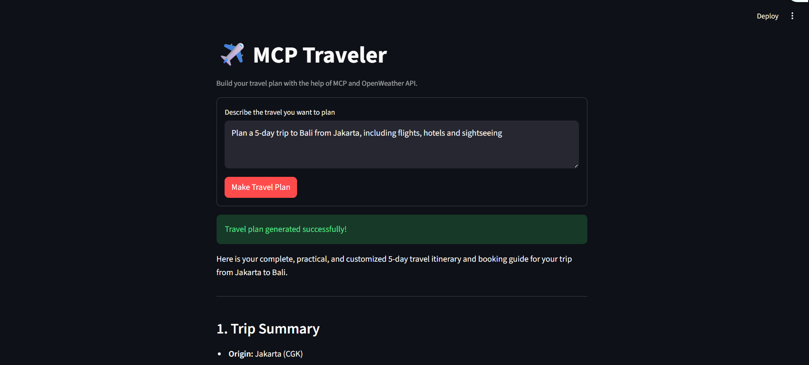
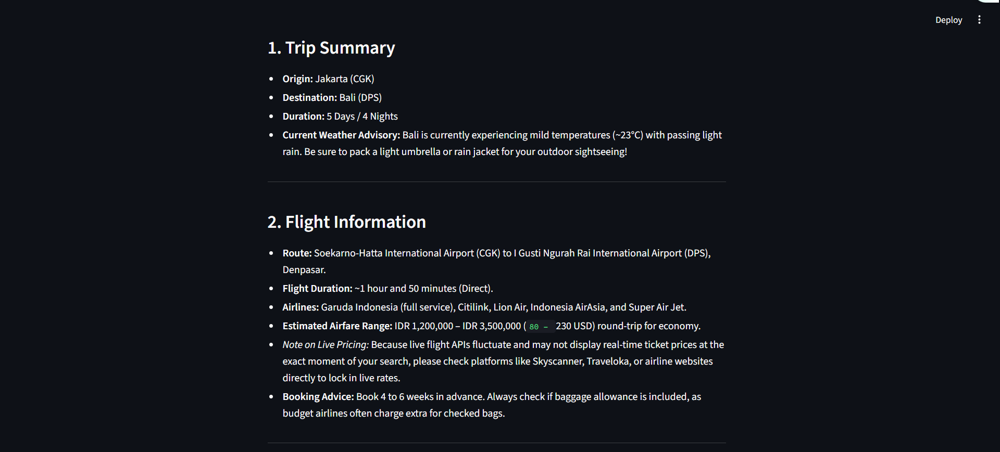
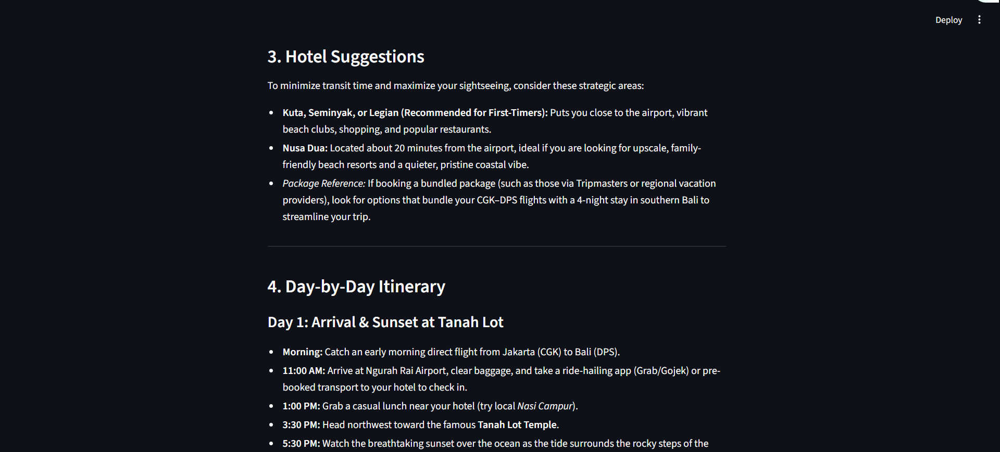
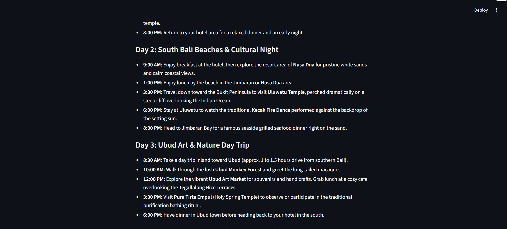
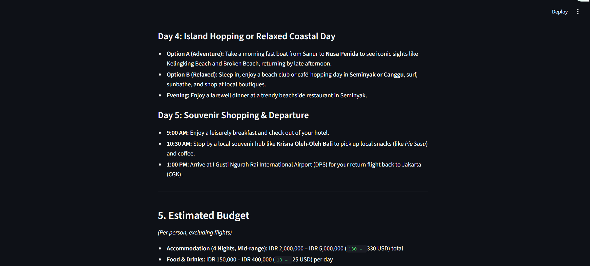
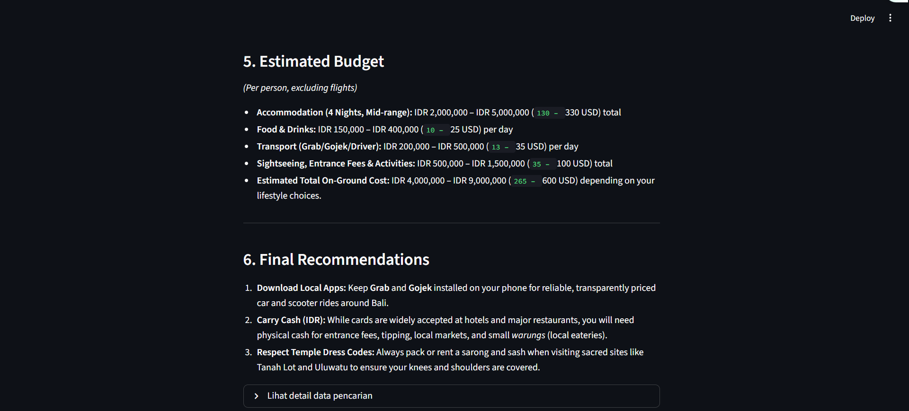
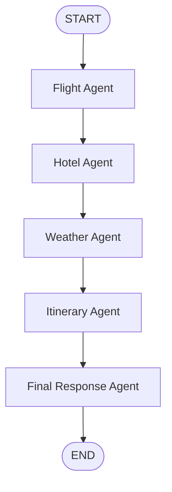

# MCP Traveler

MCP Traveler adalah aplikasi perencana perjalanan berbasis kecerdasan buatan.
Pengguna cukup menjelaskan kebutuhan perjalanannya dalam bahasa alami, lalu
sistem mengumpulkan informasi penerbangan, hotel, dan cuaca sebelum menyusun
itinerari dan rekomendasi akhir.

Proyek ini menggunakan:

- **LangGraph** untuk mengorkestrasi alur kerja agen secara berurutan.
- **Google Gemini**, melalui `ChatGoogleGenerativeAI`, untuk mengekstraksi
  lokasi, menganalisis hasil pencarian, dan menyusun itinerari.
- **Model Context Protocol (MCP)** untuk menghubungkan agen dengan Tavily,
  AviationStack, dan server cuaca lokal.
- **FastAPI** sebagai API *backend*.
- **Streamlit** sebagai antarmuka web.
- **PostgreSQL** sebagai *checkpointer* LangGraph agar konteks yang terkait
  dengan sebuah `thread_id` dapat dilanjutkan kembali.

## Pratinjau Antarmuka Streamlit

Tangkapan layar berikut memperlihatkan contoh antarmuka pengguna Streamlit:

### Permintaan perjalanan



### Informasi penerbangan



### Saran hotel



### Informasi cuaca



### Itinerari harian



### Rekomendasi akhir



## Arsitektur Tingkat Tinggi

```text
Streamlit UI
     |
     v
FastAPI (/travel)
     |
     v
LangGraph Travel Workflow
     |
     +--> AviationStack MCP ----> data bandara dan maskapai
     +--> Tavily MCP ------------> hasil pencarian hotel
     +--> Local Weather MCP -----> cuaca saat ini dan prakiraan
     |
     v
PostgreSQL Checkpointer
```

## Alur Kerja Agen

Alur kerja berjalan secara sinkron dan berurutan. Keluaran setiap agen
disimpan dalam `TravelState` dan menjadi masukan bagi agen berikutnya.



### 1. Agen Penerbangan (*Flight Agent*)

Implementasi: `flight_agent` pada `backend.py`.

Proses:

1. Membaca `user_query`.
2. Memanggil MCP AviationStack melalui `list_airports`.
3. Memanggil MCP AviationStack melalui `list_airlines`.
4. Mengirim data tersebut ke Gemini.
5. Menghasilkan informasi bandara keberangkatan dan kedatangan, maskapai yang
   melayani rute, estimasi durasi, estimasi kisaran tarif, peringatan musim
   ramai, dan saran pemesanan.
6. Menyimpan hasilnya pada `state["flight_results"]`.

Agen ini memberikan panduan penerbangan. Harga tiket bersifat estimasi dan
belum tentu selalu tersedia dari API langsung.

### 2. Agen Hotel (*Hotel Agent*)

Implementasi: `hotel_agent` pada `backend.py`.

Proses:

1. Menyusun kueri `Best hotels for <user_query>`.
2. Memanggil `tavily_search` melalui MCP Tavily.
3. Mengambil hingga lima hasil pencarian.
4. Menormalkan hasil MCP dan menampilkan judul, URL, serta cuplikan setiap
   hotel.
5. Menyimpan hasilnya pada `state["hotel_results"]`.

Tavily digunakan sebagai mesin pencari web; hasilnya bukan inventaris
pemesanan dan bukan konfirmasi ketersediaan kamar.

### 3. Agen Cuaca (*Weather Agent*)

Implementasi: `weather_agent` pada `backend.py`.

Proses:

1. Meminta Gemini mengekstraksi kota atau negara tujuan dari `user_query`.
2. Memanggil `get_current_weather` pada MCP Cuaca lokal.
3. Memanggil `get_forecast` pada MCP Cuaca lokal.
4. Menggabungkan cuaca saat ini dengan lima entri prakiraan pertama.
5. Menyimpan hasilnya pada `state["weather_results"]`.

### 4. Agen Itinerari (*Itinerary Agent*)

Implementasi: `itinerary_agent` pada `backend.py`.

Proses:

1. Membaca kueri pengguna.
2. Membaca hasil penerbangan, hotel, dan cuaca dari status (*state*).
3. Meminta Gemini menyusun itinerari yang lengkap, praktis, mudah diikuti,
   dan mempertimbangkan anggaran.
4. Menyimpan hasil harian pada `state["itinerary"]`.

### 5. Agen Jawaban Akhir (*Final Response Agent*)

Implementasi: `final_agent` pada `backend.py`.

Proses:

1. Menggabungkan permintaan pengguna dengan hasil penerbangan, hotel, cuaca,
   dan itinerari.
2. Meminta Gemini menyusun jawaban akhir yang mudah dibaca.
3. Jawaban diinstruksikan memuat Trip Summary, Flight Information, Hotel
   Suggestions, Day-by-Day Itinerary, Estimated Budget, dan Final
   Recommendations.
4. Mengembalikan jawaban akhir sebagai `answer` pada respons API.

## Server dan Alat MCP

Seluruh konfigurasi server terdapat pada `mcp_client.py` dan dikelola oleh
`MultiServerMCPClient` dari `langchain-mcp-adapters`.

| Server MCP      | Transport           | Sumber                        | Alat yang digunakan                     | Agen      |
| --------------- | ------------------- | ----------------------------- | --------------------------------------- | --------- |
| `tavily`        | Streamable HTTP     | `https://mcp.tavily.com/mcp/` | `tavily_search`                         | Hotel     |
| `aviationstack` | stdio via `uvx`     | paket `aviationstack-mcp`     | `list_airports`, `list_airlines`        | Penerbangan |
| `weather`       | stdio               | `custom_weather_mcp.py`       | `get_current_weather`, `get_forecast`  | Cuaca     |

### MCP Cuaca Lokal

`custom_weather_mcp.py` membuat server `FastMCP("Weather MCP Server")` dan
menyediakan:

- `get_current_weather(city)`: memanggil OpenWeather dan mengembalikan suhu,
  suhu yang dirasakan, kelembapan, kondisi cuaca, dan kecepatan angin.
- `get_forecast(city)`: memanggil OpenWeather dan mengembalikan lima entri
  prakiraan pertama.

### Utilitas Penerbangan Lokal

`tools/flight_tool.py` berisi utilitas untuk menerjemahkan lokasi menjadi kode
IATA (menggunakan basis data `airportsdata`, alias negara, dan `pycountry`)
serta konstanta AviationStack. Utilitas ini berguna untuk pengembangan dan
eksperimen, tetapi alur kerja aktif pada `backend.py` saat ini langsung
menggunakan alat MCP `list_airports` dan `list_airlines`.

## Struktur Proyek

```text
.
├── backend.py              # TravelState, agen, LangGraph, checkpointer PostgreSQL
├── main.py                 # Aplikasi FastAPI dan endpoint HTTP
├── mcp_client.py           # Konfigurasi klien dan adaptor server MCP
├── custom_weather_mcp.py   # Server MCP cuaca lokal
├── streamlit_app.py        # Antarmuka Streamlit
├── mcp_client_test.py      # Contoh sederhana klien MCP Tavily
├── tools/
│   └── flight_tool.py      # Utilitas resolusi lokasi/IATA
├── requirements.txt        # Daftar dependensi pip
├── pyproject.toml          # Metadata dan dependensi proyek
└── async.ipynb             # Eksperimen asinkron
```
